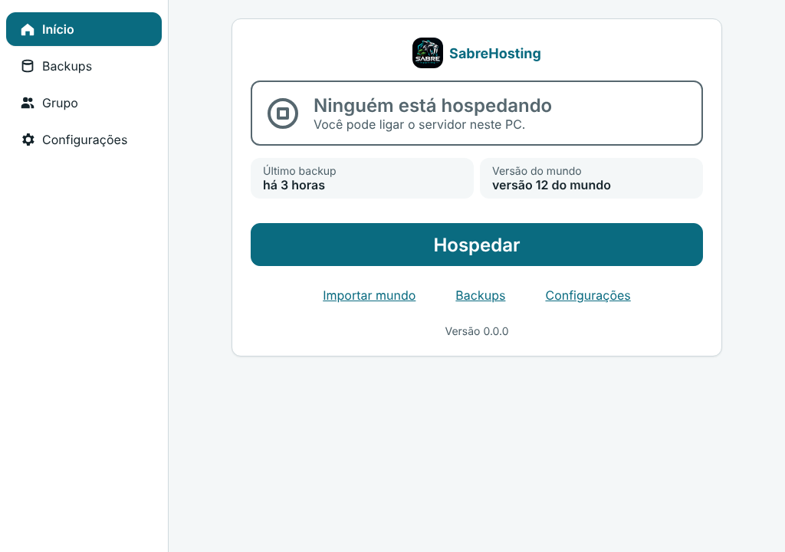
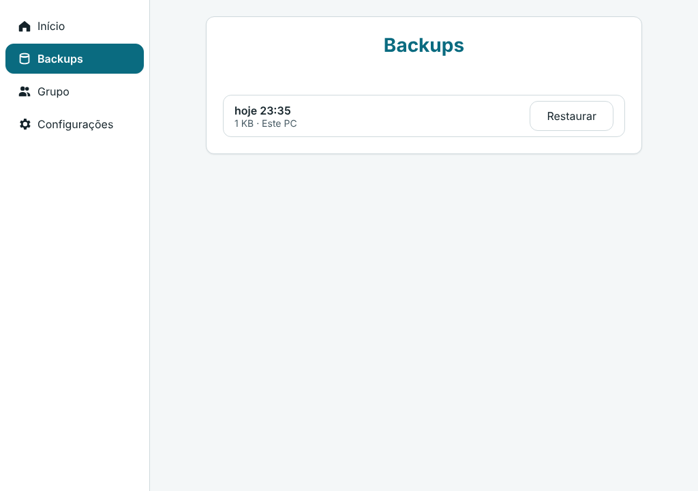
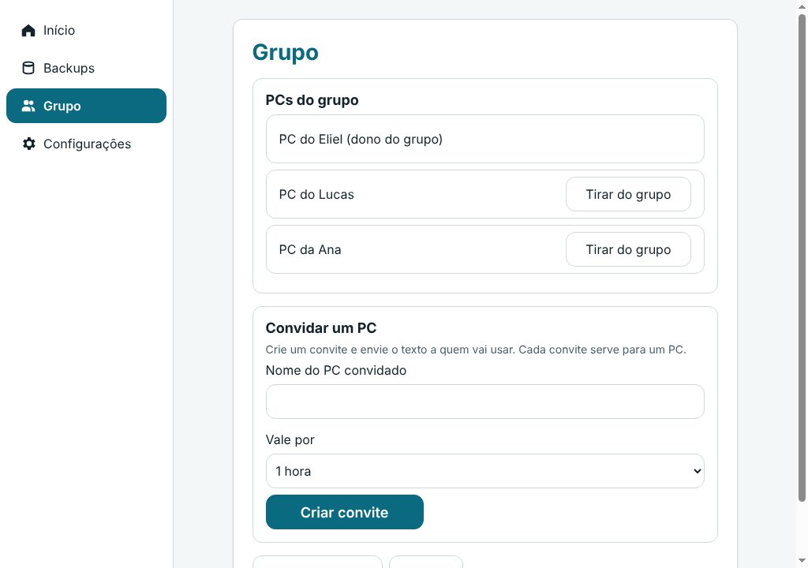
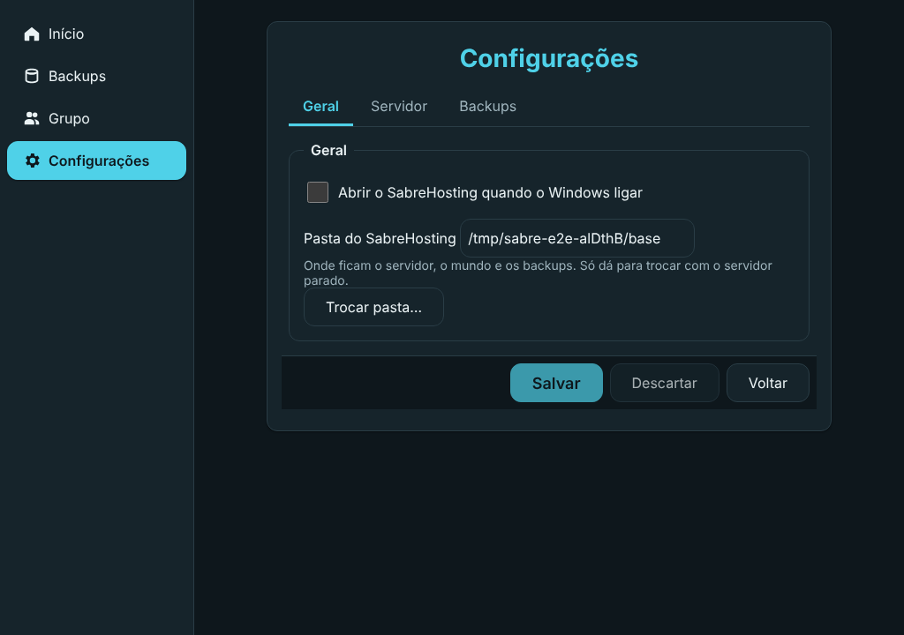

# SabreHosting

> Projeto de código aberto (MIT), sem fins comerciais.

Um app para grupos de amigos jogarem Minecraft **sem pagar hospedagem**:

- o servidor roda no **PC mais forte do grupo que estiver online**;
- quando um PC mais forte entra, o servidor **muda para ele sozinho**, sem derrubar ninguém (só uma tela de
  carregamento curta);
- o mundo fica **salvo no PC de todos** e numa máquina pequena na nuvem; quem ficou um mês fora recebe só o que mudou;
- backups automáticos, com restauração em um clique.

Como funciona por dentro: [`docs/arquitetura.md`](docs/arquitetura.md). O que está sendo feito e em que ordem:
[`docs/MILESTONE.md`](docs/MILESTONE.md) e os `docs/roadmap-*.md`.

## O app

Barra lateral fixa com **Início**, **Backups**, **Grupo** e **Configurações**, nos temas claro e escuro. A janela
aceita de 720 a 1600 px de largura. Capturas do modo demonstração (dados de mentira):

| Início | Backups |
|---|---|
|  |  |
|  |  |

## Estado

Em planejamento. Ainda não há versão para instalar.

## Contribuir

Leia [`CONTRIBUTING.md`](CONTRIBUTING.md). Falha de segurança: [`SECURITY.md`](SECURITY.md) (em privado, não abra
issue pública).

## Aviso

Não é afiliado à Mojang Studios nem à Microsoft. "Minecraft" é marca da Mojang. O app **não distribui** o servidor do
Minecraft nem o Java: baixa das fontes oficiais no seu PC, e você aceita o
[EULA do Minecraft](https://www.minecraft.net/eula) na primeira vez.

## Licença

[MIT](LICENSE).
